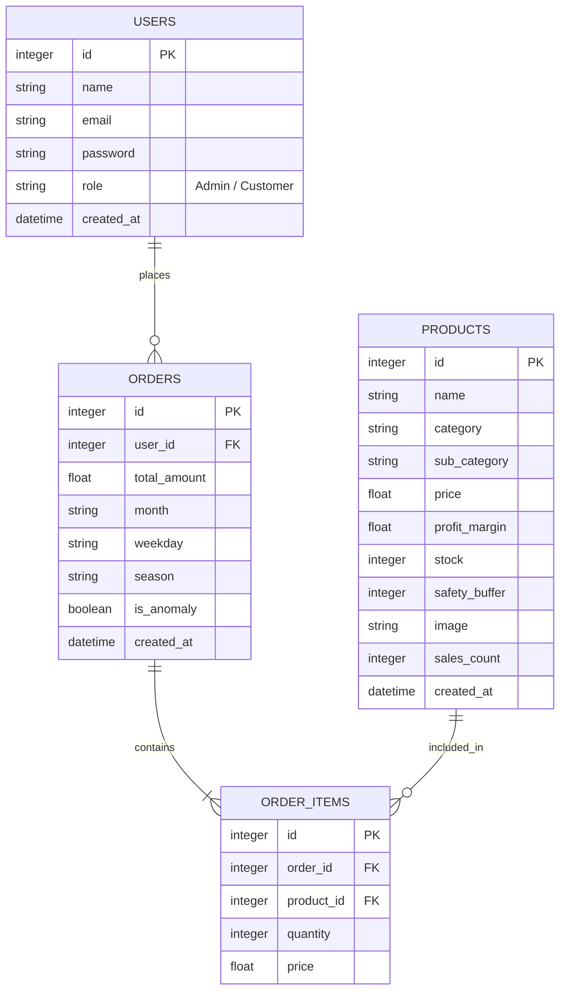

# 🗄 Database Entity-Relationship Diagram

This diagram visualizes the relational database schema used in **IntelliGrocery-Pro**.

## Tables Breakdown

### `USERS` Table
Handles system authentication and holds user profiles and roles. Role-based access control determines routing between normal customers and store admins.

### `PRODUCTS` Table
Maintains catalog information including `stock` for inventory level monitoring and alerting using the standard reorder formula (along with `safety_buffer`). Also records `profit_margin` which is critical for High Utility Itemset Mining.

### `ORDERS` Table
Summarizes customer transactions, identifying the total monetary amount and the time of purchase. It now natively stores time-extracted features (`month`, `weekday`, `season`) required for complex pattern mining, as well as an `is_anomaly` flag based on Isolation Forest anomaly detection results.

### `ORDER_ITEMS` Table
Bridge table resolving the many-to-many relationship of physical Products with individual Orders. Snapshots the `price` and specific `quantity` inside that respective order. Extremely crucial for Sequence Mining and FP-Growth rule generation.
