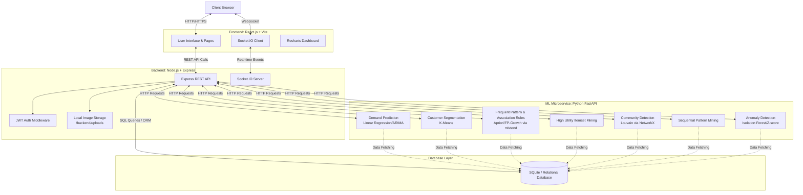

# 🏗 System Architecture Diagram

This document illustrates the high-level architecture and data flow of **IntelliGrocery-Pro**.

## System Components

### 1. **Client / Frontend Layer**
- Single Page Application (SPA) built with React.js.
- Connects to the backend via RESTful APIs for standard CRUD operations and WebSocket for real-time dashboard updates.

### 2. **Backend Services (Node.js)**
- **Express API:** Manages Routing, validation, controllers.
- **Auth Layer:** Enforces JWT-based role access control.
- **Socket.IO:** Dispatches live events to the admin dashboard on successful user orders.

### 3. **Machine Learning Microservices (Python)**
- An isolated Python FastAPI application spanning extensive data mining operations.
- Key endpoints include `/forecast`, `/cluster`, `/mba`, `/utility`, `/community`, `/sequence`, and `/anomaly`.
- Utilizes **Pandas/NumPy** for Data Preprocessing (missing values, one-hot encoding, time feature extraction).
- Uses **scikit-learn** for clustering and anomaly detection, **mlxtend** for FP-Growth/Apriori, and **NetworkX** for graph-based community detection.
- Returns predictive analytical insights back to the Node.js backend to serve up to the Admin UI.

### 4. **Database**
- Standard SQL database structure (currently SQLite for seamless local execution).
- Models are completely normalized covering basic entities. See the [Database ER Diagram](Database_ER_Diagram.md) for more info.
